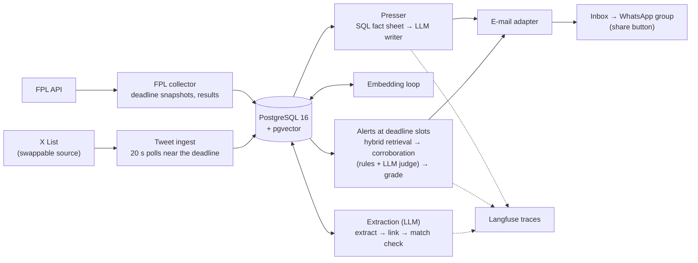

# The Gaffer's Presser

[](https://github.com/wojciechczarnecki/gaffers-presser/actions/workflows/ci.yml)

Team-news alerts and a post-gameweek press conference for Polish Fantasy Premier League
mini-leagues, built as a retrieval-augmented LLM system with an evaluation set behind every
LLM step and tracing on every call.

> Status: running locally for the owner's mini-leagues. What exists and what is planned:
> [docs/ROADMAP.md](docs/ROADMAP.md).

## What it does and why

FPL managers lose points to team news they did not see in time. Line-up leaks and injury news
appear on X minutes or hours before the deadline, scattered across dozens of accounts, while the
official FPL flags lag behind. The Gaffer's Presser does two things for a group of friends:

- **Team-news alerts.** It watches an X List of journalists and leak accounts, extracts who is
  out, doubtful, benched, starting or back to fitness, checks each claim against the other
  posts about the player, and e-mails a graded alert with cited sources for the players that
  matter to the league: a digest the evening before, news an hour before the deadline and a
  breaking e-mail per new post until the deadline.
- **League presser.** After each gameweek, a press conference for the mini-league in Polish
  FPL slang: the manager and the flop of the gameweek, captains, transfers and hits, chips, the
  key moments on the pitch, the table and overall-rank moves. Every fact comes from SQL; the
  LLM only writes.

Planned next: each account's measured leak accuracy shown in the alerts, and a Q&A agent over
the posts and the FPL data (Stage 4).

## Architecture



Every box is a loop or a job inside one long-running worker with its own scheduler, driven by
the FPL deadline calendar (cron cannot poll every 20 seconds). The design choices behind it:

- **Facts are SQL, narrative is retrieval.** Points, ranks, transfers and chips are computed by
  the database; posts are found by hybrid search (PostgreSQL full-text and pgvector, merged by
  reciprocal rank fusion).
- **The LLM does the language work, never the decisions.** Extraction returns typed events and
  a deterministic lookup links names to FPL players (the LLM only breaks ties); corroboration
  labels the extracted claims by fixed rules and sends to the LLM judge only the posts that
  retrieval alone finds; what to send and when is plain code; the presser writer gets a fact
  sheet and is judged on staying faithful to it.
- **Plain Python orchestration, recovery in the database.** LangGraph wraps the LLM steps; the
  pipeline around them is ordinary code, and a crash is recovered from the alert log and the
  delivery idempotency key rather than a checkpointer
  ([ADR 0008](docs/adr/0008-orchestration-plain-python.md)).
- **Every default model is chosen on an evaluation set**, under thresholds and a monthly budget
  set before the run; OpenRouter is the only provider, so a model change is one setting.

| Module (`backend/app/`) | Role |
|---|---|
| `fpl` | FPL API collector: players, fixtures, leagues, picks, transfers, chips, results |
| `tweets` | swappable tweet source (twscrape, twitterapi.io, official X API), List ingest, latency measurement |
| `extraction` | LLM extraction of events, player linking, the match check, its evaluation |
| `retrieval` | embeddings and hybrid search, its evaluation |
| `corroboration` | independent accounts, reversals and grades, the LLM judge and its evaluation |
| `alerts` | deadline slots, alert building and rendering, post → inbox latency |
| `presser` | fact sheet, writer, presser log, its evaluation |
| `delivery` | e-mail adapter behind an interface ([ADR 0004](docs/adr/0004-email-as-mvp-channel.md)) |
| `worker` | the scheduler, the job run log and `status` |
| `llm`, `core`, `db` | OpenRouter client, model settings and prices, tracing, models and migrations |
| `content` | Polish prompts, e-mail templates and the slang glossary, kept out of code |

Stack: Python 3.12, SQLModel, Alembic, PostgreSQL 16 + pgvector, LangGraph and LangChain
(the OpenRouter client), OpenRouter, Langfuse, uv, ruff, pytest with testcontainers, GitHub Actions. It runs locally on Docker
Compose; a Railway deployment is prepared and postponed.

## Results

Each LLM step and the latency target were measured on their own sets; the thresholds were set
before the runs. The sets are small (tens to a few hundred cases), so differences of a few
points are within noise, and every report lists its limits.

| What | Set | Metric | Threshold | Result | Default | Report |
|---|---|---|---|---|---|---|
| Post detection latency | 20 controlled posts | p95 post → first fetch | ≤ 60 s | **25.9 s** | twscrape | [report](docs/reports/tweet-source-latency-2026-09.md), [ADR 0005](docs/adr/0005-default-tweet-source-twscrape.md) |
| Extraction | v3, test, 207 cases | F1 · linking · false alarms | ≥ 0.85 · ≥ 0.95 · ≤ 5% | **0.853** · 1.000 · 1.9% (pass, 1.12 PLN a month) | `openai/gpt-6-luna` | [v3](docs/reports/extraction-eval-v3.md), [v2](docs/reports/extraction-eval-v2.md), [ADR 0010](docs/adr/0010-extraction-match-check-and-default-model.md) |
| Retrieval | v2, 69 test queries, 2,557 posts | recall at the judge's cut | — | **0.933** (hybrid, depth 20; no reranker needed) | `text-embedding-3-large` | [report](docs/reports/retrieval-eval-v2.md), [ADR 0009](docs/adr/0009-default-embedding-model.md) |
| Corroboration judge | v2, test, 75 cases | accuracy · false `supports` | ≥ 0.80 · ≤ 10% | 0.724 · 9.7%, mean of 3 runs of prompt 2 (**accuracy fails**) | `google/gemini-3.1-flash-lite` | [report](docs/reports/corroboration-eval-v2.md), [rerun](docs/reports/extraction-eval-v3.md#corroboration-regression), [ADR 0011](docs/adr/0011-corroboration-judge-model.md) |
| Presser writer | v6, test, 24 cases, writer prompt 12 | faithfulness · style (1–5) | ≥ 0.95 · ≥ 3.5 | **0.996** · 3.50 ($0.034 a presser) | `openai/gpt-6-sol` | [report](docs/reports/presser-model-comparison.md), [ADR 0007](docs/adr/0007-default-presser-model.md) |

What the numbers say:

- **Extraction passes, at the edge.** F1 0.853 against 0.85 on set v3, which added the
  `available` event type (F1 0.730, reported only) and the match check for absences (0 of 12
  false alarms from absences in other competitions). One model's runs vary by several points,
  so a repeat run could fall under the threshold; the report says so.
- **Retrieval needs no reranker.** The winner's recall at the cut is 0.933 and only 0.065 higher
  within the top 50, under the rule set beforehand for adding one.
- **The corroboration judge is the weak link.** None of six candidates passed on prompt 1
  (best 0.720 · 12.1%); the default is the one closest to the threshold, chosen by the owner.
  Prompt 2 brought false `supports` under the limit, and accuracy is still short. The failures
  sit on the `related` label (posts about a teammate or the same club read as support), which
  is the next change ([BACKLOG #58](docs/BACKLOG.md)). The judge labels only the posts that retrieval alone finds;
  the extracted claims are labelled by fixed rules.
- **The presser is faithful.** 2 unsupported claims out of 710, judged blind; the owner
  preferred the default in 3 of 3 blind pairs against `gpt-6-luna` with high reasoning, the only
  model level with it on faithfulness. Production runs writer prompt 13 (the set's version 7
  adds team names), checked by reading 6 dev pressers before and after, not re-scored.

How the labels were made: the Claude Code session acts as a blind judge through fresh
subagents, and the owner reviews the disagreements and a stratified sample (for some sets every
case); [docs/EVALUATION.md](docs/EVALUATION.md) describes the procedure.

## A sample presser

Written by the default writer for a **synthetic** case of the presser evaluation set: the
league, the managers and the team names are made up (case `syn-chip-flop` in
`backend/evals/presser/`; the text is from the model comparison run, writer prompt 12). The
judge found every claim supported by the fact sheet. It goes out as an e-mail with a "send to
WhatsApp" button, hence the WhatsApp formatting.

> 🎙️ *Presser GW7 — Liga Pod Złotym Kurem*
>
> 🏆 *Manager kolejki:* Oskar bierze trzecią wygraną w sezonie: 66 punktów netto przy średniej ligowej 55. GW rank 25k to najlepszy wynik naszej ligi w tym sezonie i jego osobisty rekord.
>
> 🤦 *Wtopa kolejki:* Konrad kończy z 45 punktami, drugi raz w sezonie i drugą kolejkę z rzędu na końcu stawki. Opaska i chip miały ratować wynik; wyszedł GW rank 1,1M.
>
> ©️ *Kapitanowie:* Haaland dał Oskarowi 16 punktów, ale u Zenka zablankował na 4. Palmer u Patryka dorzucił 12, Saka u Fabiana 10, Mbeumo u Alojzego 8. Konrad postawił potrójną opaskę na Salaha: 30 minut i 3 punkty.
>
> 🪑 *Ławka i transfery:* Oskar zostawił 5 punktów na ławce, Patryk 2. Patryk dołożył hita za 4, żeby wymienić Gordona (6) na Wissę (3): same transfery dały mu 3 punkty mniej niż sprzedany zawodnik. Trudno o lepszą reklamę cierpliwości.
>
> 🃏 *Chipy:* Free Hit Fabiana dał 3 punkty więcej niż stary skład; za tydzień wraca poprzedni. Zenek odpalił Bench Boost dla 1 punktu, a Triple Captain Konrada dołożył tylko 1. Na takie otwarcie sezonu chipów czekaliśmy?
>
> 📊 *Tabela:* Rezerwowi Marzyciele prowadzą z 392 punktami. Oskar skoczył o trzy miejsca na drugie i traci do Alojzego 6 punktów. Konrad i Patryk mają po 380 punktów na trzecim miejscu; Zenek spadł o dwie pozycje na piąte.
>
> 🌍 *Overall:* Największy skok należy do Patryka: o 1,1M miejsc, prosto do top 1M na 900k. Największy spadek u Zenka — o 50k miejsc; wypadł z top 1M i jest na 1,1M.

## How it is built

One engineer builds the project with Claude Code agents, under a spec-driven workflow
([agentic-pipeline](https://github.com/wojciechczarnecki/agentic-pipeline)) with the owner's
approval at three gates:

1. **Spec.** A feature starts as a critically reviewed [SPEC](specs/) with acceptance
   criteria; the owner approves it.
2. **Plan, review, implementation.** An agent writes the PLAN, a second agent reviews it
   adversarially with a fresh context, and the implementation runs step by step with the full
   verification (ruff and over 2,500 tests on throwaway PostgreSQL containers) after each step.
3. **Final review and PR.** Three independent review perspectives produce a findings report;
   the owner decides on each finding, the fixes go in, CI goes green, and the owner merges.
   Agents never touch `main` (a command guard and a `pre-push` hook enforce it).

Alongside the code: binding decisions in [DECISIONS](docs/DECISIONS.md) and the reasoning for
the contested ones in [ADRs](docs/adr/); deferred work with a priority and a trigger to return
in the [BACKLOG](docs/BACKLOG.md); the [roadmap](docs/ROADMAP.md) ticked in the PR that delivers the work, after green
verification;
and a definition of done for any stage that calls an LLM: its calls are traced in Langfuse and
each LLM step that produces data has an evaluation set with recorded results. A
[code audit](docs/reports/code-audit-2026-10.md) of every module in October 2026 fed a series
of hardening PRs.

## Quick start

```bash
cp backend/.env.example backend/.env   # league IDs, the tweet source, OPENROUTER_API_KEY, e-mail
docker compose up -d                   # PostgreSQL 16 with pgvector
cd backend && uv run alembic upgrade head
uv run python -m app.worker run        # every loop its settings enable
uv run python -m app.worker status     # the state of every loop
```

Tests need Docker but no running database:

```bash
cd backend && uv run ruff check . && uv run ruff format --check . && uv run pytest -q -n auto
```

Every module's command-line tools, its settings and the evaluation commands are in
[docs/DEVELOPMENT.md](docs/DEVELOPMENT.md).

## Documentation

| Document | Contents |
|---|---|
| [docs/PROJECT.md](docs/PROJECT.md) | problem, requirements, architecture, risks |
| [docs/ROADMAP.md](docs/ROADMAP.md) | stages and their status |
| [docs/DEVELOPMENT.md](docs/DEVELOPMENT.md) | running every module, configuration, evaluation commands |
| [docs/DECISIONS.md](docs/DECISIONS.md) and [docs/adr/](docs/adr/) | design decisions and their reasoning |
| [docs/EVALUATION.md](docs/EVALUATION.md) | running an LLM-judged evaluation with the Claude Code session as the judge |
| [docs/reports/](docs/reports/) | evaluation and measurement reports, the code audit |
| [docs/CONVENTIONS.md](docs/CONVENTIONS.md) | code, tests, git |
| [docs/DEPLOYMENT.md](docs/DEPLOYMENT.md) | deployment runbook (Railway, postponed) |

## Deployment

The worker and PostgreSQL run locally on Docker Compose. A Railway deployment is prepared (the
Docker image from `backend/Dockerfile`, built and smoke-tested in CI, and `railway.json` at the
repository root) and postponed until the system has to run without the owner's computer; the runbook is in
[docs/DEPLOYMENT.md](docs/DEPLOYMENT.md).

## License

Copyright © 2026 Wojciech Czarnecki. All rights reserved. The source is public for review as
a portfolio project; no licence to use, copy or distribute it is granted.

*Not affiliated with the Premier League or Fantasy Premier League.*
